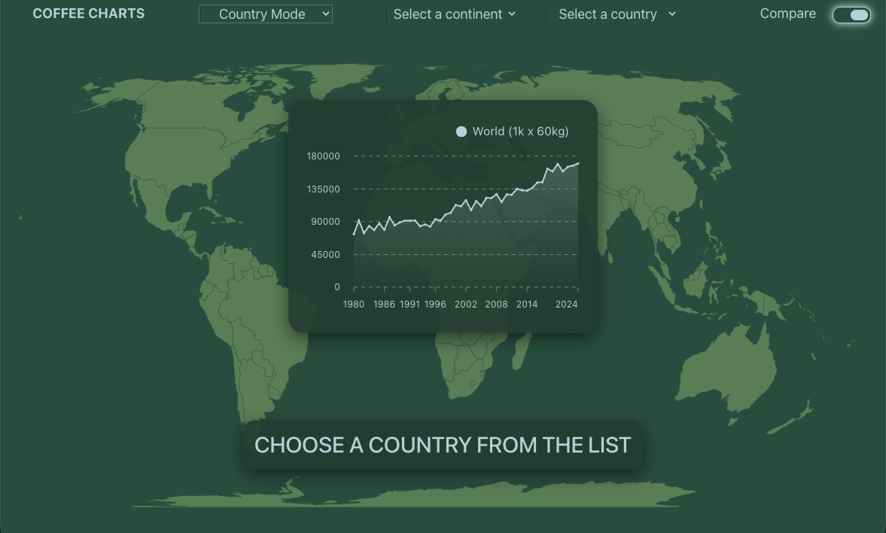

# Arabica Coffee Dashboard 2.0 — Global & Country Production Analytics

A full-stack dashboard that visualizes Arabica coffee production from the official **FAOSTAT API**. Version 2.0 extends the v1.0 foundation with a **Global Mode** and a **Country Mode**, a curated producer-country catalog with continent filtering, an interactive world map, and a comparison of country production against the global series. Data is fetched securely through an Express proxy and rendered with React, Redux Toolkit, Mantine Charts, and react-simple-maps.

This is the second step of a larger coffee analytics project. Version 1.0 validated the product idea, the architecture, and the data flow. Version 2.0 builds on that base to add multi-view analytics and richer country selection, and it is still a stepping stone toward a more complete dashboard ecosystem.



---

## ✨ What's New in Version 2.0

- **Global Mode (default):** the app opens on global Arabica production so the overall trend is visible immediately.
- **Country Mode:** a navbar control switches to a single country, showing its production alongside the global series for comparison.
- **Mode switcher in the navbar:** toggles between Global and Country views without reloading the page.
- **Continent and country selectors:** choosing a continent filters the country options; changing the continent clears the selected country if it falls outside that continent.
- **World comparison switch:** shows or hides the global series in Country Mode.
- **Interactive world map:** highlights every producer country in Global Mode, or only the selected country in Country Mode.
- **Persistent selections:** the selected country is kept when switching modes, and global data is loaded once and reused.
- **Curated country catalog:** a typed server-side list of producer countries (name, slug, FAOSTAT area code, ISO numeric code, and continent) served to the client through its own endpoint.
- **Updated layout and styling:** a revised dashboard composition for both modes, with responsive behavior preserved.

---

## 🛠 Tech Stack & Tools

- **Frontend (`client/`)**:
  - **Framework**: [React 19](https://react.dev/) + [TypeScript](https://www.typescriptlang.org/) + [Vite](https://vitejs.dev/)
  - **State Management**: [Redux Toolkit](https://redux-toolkit.js.org/) with feature slices for mode, selection, catalog, and production; async thunks for both global and country data
  - **UI & Visualization**: [Mantine Core](https://mantine.dev/) (navbar, selectors, switches, layout), [Mantine Charts](https://mantine.dev/charts/installation/) (Recharts), [react-simple-maps](https://www.npmjs.com/package/react-simple-maps) with [world-atlas](https://www.npmjs.com/package/world-atlas) TopoJSON geometry
  - **HTTP Client**: [axios](https://axios-http.com/)
  - **Testing**: [Vitest](https://vitest.dev/), [@testing-library/react](https://testing-library.com/), [@testing-library/jest-dom](https://testing-library.com/docs/ecosystem-jest-dom/)

- **Backend (`server/`)**:
  - **Runtime & Framework**: [Node.js](https://nodejs.org/) + [Express 5](https://expressjs.com/) + [TypeScript](https://www.typescriptlang.org/)
  - **Development Tooling**: `ts-node-dev` (hot reload)
  - **Data & Domain Layer**: a dedicated typed country-data module as the single source of truth for the curated catalog, separate from the production controller
  - **Middleware & Security**: Token-based authentication manager for the FAOSTAT API, CORS, environment-based secret management
  - **Testing**: [Jest](https://jestjs.io/), [Supertest](https://github.com/ladjs/supertest)

- **End-to-End Testing (`e2e/`)**:
  - **Framework**: [Playwright](https://playwright.dev/), extended to cover mode switching, continent filtering, and chart content

- **Automation / CI**:
  - **Workflow Validation**: [GitHub Actions](https://github.com/features/actions) running client, server, and E2E test suites on push and pull request

---

## Required Environment Variables & FAOSTAT Registration

To run the application backend and retrieve production statistics, **you must configure environment variables**.

### Important Notice: FAOSTAT Registration
The backend proxy authenticates against the official FAOSTAT API using user credentials. Before starting the server:

1. **Register an Account**: Go to the [FAOSTAT Portal / Services](https://www.fao.org/faostat/en/#developer-portal) and create a free user account.
2. **Environment File Setup**: Create a `.env` file inside the `server/` directory (you can copy `server/.env.example`).
Add your FAOSTAT login credentials to `server/.env`:

```env
# Mandatory FAOSTAT API Credentials
FAOSTAT_USER=your_registered_email@example.com
FAOSTAT_PASSWORD=your_faostat_password

# Optional Configuration
PORT=4040
```

> 📌 **Note:** Without valid `FAOSTAT_USER` and `FAOSTAT_PASSWORD` environment variables, the backend server will refuse to start and throw a missing variable error.

---

## Getting Started

### 1. Installation

Navigate to the `arabica-coffee-dashboard` folder and install dependencies across sub-projects:

```bash
# Install root/workspace scripts if applicable, or install dependencies per package:

# Client dependencies
cd client && npm install

# Server dependencies
cd ../server && npm install

# E2E dependencies
cd ../e2e && npm install
```

### 2. Running the Development Servers

1. **Start the Express Proxy Backend**:
   ```bash
   cd server
   npm run dev
   ```
   *The server runs by default on `http://localhost:4040`.*

2. **Start the React Frontend**:
   ```bash
   cd client
   npm run dev
   ```
   *Open the URL output in your terminal (typically `http://localhost:5173`).*

---

## 🧪 Running Tests

The workspace includes scripts at the root of `arabica-coffee-dashboard` to run all test suites conveniently:

From the `arabica-coffee-dashboard/` folder:

```bash
# Run client unit & integration tests (Vitest)
npm run test:client

# Run server API tests (Jest & Supertest)
npm run test:server

# Run Playwright E2E tests
npm run test:e2e

# Run all test suites sequentially
npm run test:all
```

---

## 📂 Project Structure

```text
arabica-coffee-dashboard/
├── client/          # React + Vite frontend application
│   ├── src/
│   │   ├── components/    # Navbar, Graph, WorldMap, TargetData
│   │   ├── features/      # Redux slices: catalog, mode, production, selection
│   │   │                  # plus their UI (ModeSelection, VariableSelection,
│   │   │                  # WorldComparisonToggle, ProductionGraphic)
│   │   └── hooks/         # Custom Redux typed hooks
│   └── tests/
│       ├── fixtures/      # Catalog and production test data
│       ├── helpers/       # Store and render helpers
│       ├── integration/   # Components connected to a real Redux store
│       └── unit/          # Slice and reducer tests
├── server/          # Express proxy backend API
│   ├── src/
│   │   ├── controllers/   # Production and catalog controllers
│   │   ├── data/          # Curated country catalog (countryData)
│   │   ├── middleware/    # FAOSTAT Token Auth manager
│   │   ├── routes/        # Production and catalog route definitions
│   │   ├── types/         # FAOSTAT and catalog types
│   │   └── utils/         # AppError and response helpers
│   └── tests/             # Jest backend integration tests
└── e2e/             # Playwright E2E test suites
```
