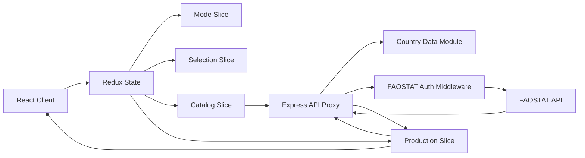

# Coffee Data Dashboard 2.0 – Technical Documentation

## Project Description

Arabica Coffee Dashboard is the second step of a larger coffee analytics project. Version 1.0 established the foundation: a full-stack proof of concept that visualizes Arabica production for a set of countries using official FAOSTAT data. Version 2.0 builds on that base and turns the single-country view into a two-mode analytics dashboard, with a global view and a country view that can be compared side by side.

The project still focuses on Arabica production trends from FAOSTAT, and it keeps the core patterns introduced in v1.0: a secure Express proxy, normalized data, Redux Toolkit state, and a layered test suite. Version 2.0 adds mode-based composition, a curated country catalog, independent global and country datasets, and an interactive world map. It is a stepping stone toward a richer analytics ecosystem, not a final product.

---

## Goals

The primary goal is to evolve the v1.0 prototype into a multi-view dashboard while keeping the architecture, security model, and quality gates from the first release.

Version 2.0 aims to:

- Keep the v1.0 secure backend proxy and normalization pattern, extending it to global production and a country catalog.
- Let users start in a global view and switch to a country view.
- Show a selected country's production next to the global series for comparison.
- Provide continent-based filtering of countries, derived locally from a single catalog.
- Visualize producer countries on an interactive world map that reflects the current mode and selection.
- Keep global and country datasets independent, each with its own data, status, and error state.
- Preserve the v1.0 quality baseline: Vitest, Jest, Supertest, Playwright, and GitHub Actions CI, with tests added alongside each step.

---

## Problematics

### From Version 1.0

#### 1. Direct access to external data is restricted
The FAOSTAT API requires authentication and does not allow the client application to use credentials directly in the browser. A direct browser call would expose credentials and violate the API's intended usage model.

#### 2. External data is not delivered in a frontend-ready format
The FAOSTAT payload contains metadata that the chart does not need. The application needs only the year and the production value, so the response must be transformed before rendering.

#### 3. Users need a comparative, interactive experience
A static chart is not enough for a dashboard. Users must be able to change the selection and see the trend update without a page refresh.

#### 4. Data access must be resilient and maintainable
The backend must handle authentication, token expiration, and upstream errors gracefully, since third-party systems require periodic token renewal.

#### 5. UI state needs to remain predictable
When the selection changes, chart data and UI state must update consistently. Without structured state management, the application becomes harder to scale and test.

### Added in Version 2.0

#### 6. A single view cannot show both the global trend and a country's place within it
Users need to see the world series and a selected country's series together. Showing one at a time forces the user to compare values from memory.

#### 7. The app needs two modes with different data needs
Global Mode needs only the global series, while Country Mode needs the selected country plus the global series. The app must decide what to load and render for each mode without duplicating logic.

#### 8. Country metadata is scattered and filtering is ambiguous
Names, FAOSTAT codes, map identifiers, and continents must live in one place. Filtering by continent should not require a request per change or a duplicated list of countries.

#### 9. Several identifier systems must not be confused
FAOSTAT area codes are used for upstream requests. The map's geometry identifiers are ISO 3166-1 numeric codes. Treating these as interchangeable would silently break the map or the API calls.

#### 10. Global data must be reusable across mode switches
Switching modes should not trigger refetches of data that is already loaded, and the global series should not be tied to the currently selected country.

---

## How I'm Addressing Each Problematic

### From Version 1.0

#### 1. Securing external API access
The Express backend is a proxy between the frontend and FAOSTAT. The client never calls the FAOSTAT service directly. The server authenticates with the login endpoint and stores the access token locally. Credentials live in environment variables on the server.

#### 2. Normalizing external responses
The backend controller maps the raw FAOSTAT response into a simplified structure with only the fields the dashboard needs (`year` and `value`). The chart receives a clean model that is easy to render and validate.

#### 3. Enabling interactive selection
Redux Toolkit slices hold the selection state. Choosing a country updates the store and triggers a new production request, so the dashboard reacts immediately to user input.

#### 4. Handling token lifecycle and API errors
The authentication middleware checks whether the token is missing or close to expiration before each request. If the token is expired or invalid, it logs in again and renews the cached value. Upstream errors are caught and returned as controlled responses rather than raw failures.

#### 5. Improving maintainability and testability
Redux slices and typed hooks make state explicit. Separate folders for features, components, controllers, and routes keep responsibilities clear, and unit and integration tests cover both frontend and backend behavior.

### Added in Version 2.0

#### 6. Showing global and country series together
Country Mode renders the selected country's series and the global series in the same chart. A world comparison switch can hide the global series, so the user chooses between a comparison view and a country-only view.

#### 7. Separating modes at the state level
The dashboard mode (`'global' | 'country'`, initially `'global'`) lives in its own small Redux slice. The navbar changes it, and `App` reads it to choose which view to render. The conditional rendering stays in `App`; the mode itself is state.

#### 8. Centralizing the catalog and filtering locally
A typed server-side country-data module is the single source of truth for the curated catalog: display name, stable slug, FAOSTAT area code, ISO numeric code for map joins, and continent. A catalog endpoint returns only the UI-safe fields, which the client loads once. Visible countries are derived from the catalog and the selected continent at render time, so no filtered copy is stored. When the continent changes, the selected country is cleared if it no longer belongs to that continent.

#### 9. Keeping identifier systems distinct
- FAOSTAT area codes are used only by server-side FAOSTAT requests.
- The `world-atlas` geometry `id` is the ISO 3166-1 numeric code. It is stored and compared as a string so leading zeroes are preserved.
- The two systems are never assumed to be interchangeable.

#### 10. Independent global and country datasets
Global and country production are kept in the production slice as separate datasets, each with its own data, status, and error. Global data is requested independently of the selected country and retained across mode switches, so it is not refetched when the user changes modes.

---

## Architecture

The application keeps the layered architecture from v1.0 and adds a mode and catalog layer on the client and a catalog data module on the server.



### Frontend layer
The client is built with React 19, TypeScript, and Vite. It renders the navbar, the mode-specific views, the selectors, the chart, and the world map. Redux Toolkit holds mode, selection, catalog, and production state. Components read from the store and dispatch actions; they do not own cross-cutting state.

### Backend layer
The Express server exposes routes for global production, country production (using the curated mapping), and the country catalog. It authenticates to FAOSTAT through the auth middleware, normalizes upstream responses, and returns only what the client needs.

### Country data layer
A dedicated, typed module under `server/src/data/` holds the curated producer-country list. The production controller looks countries up through this module. The catalog endpoint maps the same array to UI-safe fields. A `Map` keyed by slug is a documented optimization to apply only if the list grows substantially, since the current list is small.

### Data flow

**Startup**
1. The client loads the country catalog once, on app start or when Country Mode is first opened.
2. The client loads global production independently of the selected country, so it is available in both modes.

**Global Mode**
1. The navbar shows only the mode selector.
2. The chart renders the global series alone.
3. The world map fills every producer country.

**Country Mode**
1. The user picks a continent. The client filters the catalog locally and clears the selected country if it is no longer valid.
2. The user picks a country. Redux stores the selection.
3. The client requests production for that country from the backend.
4. The backend validates or refreshes the FAOSTAT token, fetches the values, and normalizes them.
5. The chart renders the country series together with the global series, unless the world comparison switch is off.
6. The world map fills only the selected country, matched by its ISO numeric `geoId`.

Switching modes preserves the selected country and does not refetch global data.

The project also includes a CI layer built with GitHub Actions. Every push and pull request triggers validation for the client, server, and end-to-end suites.

---

## Client State Design

| Slice | Responsibility |
|---|---|
| `modeSlice` | Dashboard mode: `'global' \| 'country'`, initially `'global'`. |
| `selectionSlice` | Selected continent and country, plus `showWorldComparison` (initially `true`). Choosing a continent clears the country. |
| `catalogSlice` | UI-safe country metadata and its load status. Loaded once. |
| `productionSlice` | Global and selected-country datasets, each with its own data, status, and error. |

Key behaviors:

- Mode changes do not reset the selected country.
- Country production `pending` clears previous data and sets a pending status; `fulfilled` stores data; `rejected` clears data and records the error message.
- Global production has its own `pending`, `fulfilled`, and `rejected` handling via a separate async thunk.

---

## Server API

| Method | Route | Purpose |
|---|---|---|
| `GET` | `/api/production/` | Global production (empty slug). |
| `GET` | `/api/production/:country` | Production for a supported country slug, using the centralized country mapping. Unsupported slugs are rejected. |
| `GET` | `/api/catalog` | Returns only the UI-safe catalog fields. |

Route paths are unambiguous: the global route is registered so it does not collide with the dynamic country parameter. Production responses keep the normalized `year` and `value` shape from v1.0.

---

## Tools, Technologies and Protocols

### Frontend
- React 19
- TypeScript
- Vite
- Redux Toolkit (feature slices for mode, selection, catalog, and production; async thunks)
- Mantine Charts / Recharts (area chart via `Graph`)
- react-simple-maps with world-atlas TopoJSON (`WorldMap`)
- axios for HTTP requests to the backend

### Backend
- Node.js
- Express 5
- TypeScript
- CORS middleware
- Typed country-data module for the curated catalog
- Native fetch for FAOSTAT communication

### Testing and automation
- Vitest and Testing Library for client unit and integration tests
- Jest and Supertest for server tests
- Playwright for end-to-end tests (mode switching, filtering, chart content)
- GitHub Actions for CI validation on push and pull request events

### Protocols and communication standards
- HTTP/HTTPS for client-server communication
- REST-style API endpoints
- Token-based authentication for FAOSTAT access
- Form-encoded login request to the FAOSTAT auth endpoint
- CORS enabled for frontend-backend interoperability

### Security considerations
- Credentials are stored in environment variables, not in the frontend bundle.
- External API access is mediated by the backend proxy.
- Token refresh is handled server-side to avoid stale or invalid authentication.
- The client receives only UI-safe catalog fields, not the full server-side country records.

---

## Testing Strategy

Version 2.0 keeps the v1.0 quality baseline and extends it in focused steps.

- **Unit tests** check one piece in isolation: `selectionSlice`, `modeSlice`, `productionSlice`, and the `mergeByYear` helper, which combines world and country values by year and leaves a field `undefined` when a year is missing from one dataset.
- **Integration tests** connect components to a real Redux store, with the network and third-party rendering mocked. They cover the navbar's mode-dependent controls, continent-filtered country options, the target heading and prompt, the production graphic's series visibility, and the map's fill logic.
- **E2E tests** (Playwright) cover real map loading, chart rendering, mode switching, filtering, and layout, which need the real backend and FAOSTAT.
- **Server tests** cover supported and unsupported countries, catalog output, global production normalization, and route behavior.

Each implementation step adds tests alongside the change, and the full client, server, and E2E suites run before a version is considered complete.

---

## Project Structure

```text
arabica-coffee-dashboard/
├── client/
│   ├── src/
│   │   ├── components/
│   │   │   ├── Graph.tsx            # Area chart wrapper (Mantine Charts)
│   │   │   ├── Navbar.tsx           # Mode switcher and mode-dependent controls
│   │   │   ├── TargetData.tsx       # Heading and selection prompt
│   │   │   └── WorldMap.tsx         # react-simple-maps choropleth
│   │   ├── features/
│   │   │   ├── catalog/
│   │   │   │   └── catalogSlice.ts
│   │   │   ├── mode/
│   │   │   │   ├── ModeSelection.tsx
│   │   │   │   └── modeSlice.ts
│   │   │   ├── production/
│   │   │   │   ├── ProductionGraphic.tsx
│   │   │   │   └── productionSlice.ts
│   │   │   └── selection/
│   │   │       ├── VariableSelection.tsx
│   │   │       ├── WorldComparisonToggle.tsx
│   │   │       └── selectionSlice.ts
│   │   ├── hooks/
│   │   │   └── index.ts
│   │   ├── App.tsx
│   │   ├── App.css
│   │   ├── index.css
│   │   ├── main.tsx
│   │   └── store.ts
│   ├── tests/
│   │   ├── fixtures/                # catalogFixture, productionFixture
│   │   ├── helpers/                 # makeStore, renderWithStore
│   │   ├── integration/             # Component tests with a real store
│   │   ├── unit/                    # Slice tests
│   │   └── setup.ts
│   ├── package.json
│   ├── vite.config.ts
│   └── README.md
│
├── server/
│   ├── src/
│   │   ├── controllers/
│   │   │   ├── catalogController.ts
│   │   │   └── productionController.ts
│   │   ├── data/
│   │   │   └── countryData.ts       # Curated producer-country catalog
│   │   ├── middleware/
│   │   │   └── authManager.ts
│   │   ├── routes/
│   │   │   ├── catalogRoute.ts
│   │   │   └── productionRoute.ts
│   │   ├── types/
│   │   │   ├── catalogTypes.ts
│   │   │   └── faostatTypes.ts
│   │   ├── utils/
│   │   │   ├── AppError.ts
│   │   │   └── response.ts
│   │   ├── app.ts
│   │   └── index.ts
│   ├── tests/
│   │   ├── auth.test.ts
│   │   ├── catalogData.test.ts
│   │   ├── countryProd.test.ts
│   │   ├── globalProd.test.ts
│   │   ├── helpers/
│   │   │   └── testHelpers.ts
│   │   └── types/
│   │       └── testTypes.ts
│   ├── package.json
│   └── tsconfig.json
│
├── e2e/
│   ├── dashboard.spec.ts
│   ├── package.json
│   └── playwright.config.ts
│
├── README.md
├── TECHNICAL_DOC.md
├── V2_IMPLEMENTATION_PLAN.md
├── package.json
└── .gitignore
```

### Architectural interpretation of the structure
- The client folder contains all visualization and interaction logic, organized by feature.
- The server folder contains the secure backend integration, the curated country data, and normalization logic.
- The e2e folder validates the app behavior from the user perspective.
- The root package acts as a test orchestrator for the sub-projects.

---

## Final Portfolio Summary

Arabica Coffee Dashboard is a focused full-stack project that demonstrates how to grow a data visualization application from a single-view prototype into a multi-mode analytics dashboard. Version 1.0 proved the secure API integration, normalization, and state foundations. Version 2.0 adds mode-based composition, a centralized country catalog, independent global and country datasets, an interactive world map, and continued test coverage across frontend, backend, and E2E levels.

This project is particularly valuable for a portfolio because it showcases practical experience with:

- full-stack application design and incremental versioning
- React and TypeScript development
- Redux state management with independent feature slices
- secure backend API proxying and centralized domain data
- data cleaning, normalization, and identifier mapping
- third-party API integration (FAOSTAT) and map visualization
- planning through a written implementation plan
- automated validation through GitHub Actions CI
- testing across frontend, backend, and E2E levels
